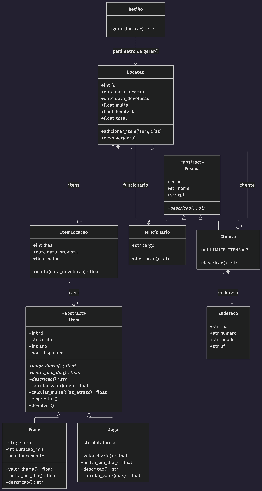

# Locadora

    

**Locadora** é um sistema de locadora de **filmes e jogos** desenvolvido em Python. Nasceu como projeto acadêmico para praticar **Programação Orientada a Objetos** — herança, polimorfismo, composição, associação e dependência — num problema com regras de negócio de verdade: preços diferentes por tipo de item, prazos, multa por atraso e limite de itens por cliente.

Tudo usa apenas a biblioteca padrão do Python, com os dados guardados em **SQLite**.

## 📂 Estrutura do repositório

Este repositório reúne duas versões do mesmo sistema, cada uma com uma proposta diferente — por isso, cada pasta tem seu próprio README com detalhes específicos:

| Pasta | O que é | Leia mais |
| --- | --- | --- |
| [`terminal/`](terminal) | A base do projeto: modelos, banco, regras de negócio e um menu interativo no terminal. Sem interface gráfica e sem dependências. | [README](terminal/README.md) |
| [`interface-grafica/`](interface-grafica) | A evolução do projeto: a mesma base, agora com janelas e botões em **Tkinter**. Mantém o menu de terminal também. | [README](interface-grafica/README.md) |
| [`UML/`](UML) | Diagrama de classes do projeto, em imagem e no código-fonte Mermaid. | — |

## A ideia por trás do projeto

Independente da pasta, as duas versões compartilham o mesmo design em camadas:

- **Modelos** (`models/`): as classes do domínio — `Pessoa`, `Cliente`, `Funcionario`, `Endereco`, `Item`, `Filme`, `Jogo`, `Locacao`, `ItemLocacao` e `Recibo`. É aqui que mora a POO.
- **Persistência** (`database.py` e `repositorios.py`): conexão com o SQLite e um repositório para cada entidade, que transforma linhas do banco em objetos.
- **Serviços** (`servicos.py`): a classe `Locadora`, que concentra as regras de negócio e é a única porta de entrada para qualquer interface.
- **Interface** (`menu.py` e `gui.py`): só pergunta e mostra. Não toma decisão nenhuma — por isso dá para trocar o terminal pelas janelas sem mexer em uma linha das regras.

##  Conceitos de POO aplicados

| Conceito | Onde aparece |
| --- | --- |
| **Herança** | `Cliente` e `Funcionario` herdam de `Pessoa`; `Filme` e `Jogo` herdam de `Item` (ambas classes abstratas). |
| **Polimorfismo** | Cada tipo de item calcula diária, multa e descrição do seu jeito. O `Jogo` ainda sobrescreve `calcular_valor` para aplicar desconto. |
| **Composição** | O `Cliente` cria o seu próprio `Endereco`; a `Locacao` cria os seus `ItemLocacao`. Essas partes não fazem sentido sozinhas. |
| **Associação** | A `Locacao` se liga a um `Cliente` e a um `Funcionario`; cada `ItemLocacao` se liga a um `Item`. Esses objetos existem por conta própria. |
| **Dependência** | O `Recibo` só recebe uma `Locacao` como parâmetro para montar o texto, sem guardá-la. |



##  Regras de negócio

| Item | Diária | Multa por dia de atraso |
| --- | --- | --- |
| Filme | R$ 6,00 | R$ 2,00 |
| Filme lançamento | R$ 9,00 | R$ 3,00 |
| Jogo | R$ 10,00 (10% de desconto a partir de 5 dias) | R$ 4,00 |

- Cada cliente pode ficar com no máximo **3 itens** alugados ao mesmo tempo.
- Uma locação pode ter vários itens, cada um com o seu prazo.
- A multa é calculada item por item na devolução, e o recibo mostra o total final.

##  Testes

As duas versões têm testes automáticos com `unittest` — modelos e regras de negócio, usando banco em memória. Para rodar, dentro da pasta da versão escolhida:

```
python -m unittest discover -s tests -t .
```

## Por onde começar

- Quer entender as regras e o design sem interface nenhuma no meio? Vá direto ao [`terminal/`](terminal).
- Quer ver o sistema funcionando com janelas e botões? Veja [`interface-grafica/`](interface-grafica).
- Quer ver como as classes se relacionam? Abra o [diagrama de classes](UML/diagrama_classes.png).

## Autor

Neylor Cruz — [@N3ylim](https://github.com/N3ylim)
