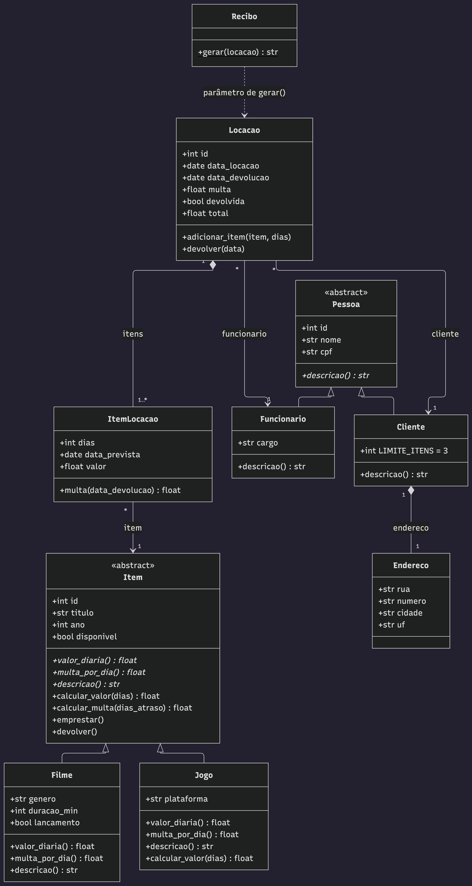

# Locadora — Sistema de locação de filmes e jogos

    

Projeto de locadora de **filmes e jogos** desenvolvido em Python para aplicar conceitos de **Programação Orientada a Objetos (POO)** em um sistema com regras de negócio, persistência de dados e diferentes interfaces.

O repositório acompanha a evolução da aplicação: primeiro um programa de terminal, depois uma interface gráfica com Tkinter e, por fim, uma versão web com Flask e Docker.

## Versões disponíveis

| Versão | Interface | Tecnologias | Documentação |
| --- | --- | --- | --- |
| [`terminal/`](terminal/) | Menu no terminal | Python, SQLite | [README](terminal/README.md) |
| [`interface-grafica/`](interface-grafica/) | Janelas desktop | Python, Tkinter, SQLite | [README](interface-grafica/README.md) |
| [`Locadora-Web/`](Locadora-Web/) | Navegador | Python, Flask, HTML, CSS, SQLite, Docker | [README da versão web](Locadora-Web/README.md) |

## Funcionalidades

- Cadastro e gerenciamento de clientes e funcionários.
- Cadastro e gerenciamento de filmes e jogos.
- Registro de locações com múltiplos itens e prazos individuais.
- Devolução de itens e cálculo de multas por atraso.
- Limite de três itens alugados simultaneamente por cliente.
- Consulta de locações e geração de recibos.

> As interfaces têm formas de uso diferentes. Consulte o README de cada versão para os detalhes e comandos de execução.

## Arquitetura

A aplicação separa responsabilidades em camadas:

- **Modelos (`models/`):** entidades e conceitos de POO, como herança, polimorfismo e composição.
- **Persistência (`database.py`, `repositorios.py`):** armazenamento e recuperação de dados em SQLite.
- **Serviços (`servicos.py`):** regras de negócio compartilhadas pelas interfaces.
- **Interfaces:** menu de terminal, janelas Tkinter ou páginas Flask.

### Diagrama de classes



Os arquivos do diagrama estão em [`UML/`](UML/).

## Regras de negócio

| Tipo de item | Diária | Multa por dia de atraso |
| --- | --- | --- |
| Filme | R$ 6,00 | R$ 2,00 |
| Filme lançamento | R$ 9,00 | R$ 3,00 |
| Jogo | R$ 10,00 (10% de desconto a partir de 5 dias) | R$ 4,00 |

Uma locação pode incluir mais de um item, cada qual com seu prazo. O cálculo de multas considera os itens individualmente.

## Executar a versão web com Docker

Com Docker Desktop instalado e iniciado:

```bash
git clone https://github.com/N3ylor/Locadora.git
cd Locadora/Locadora-Web
docker compose up --build -d
```

Abra **http://localhost:8000** no navegador. Para interromper a aplicação, execute `docker compose down` dentro da pasta `Locadora-Web`.

A documentação completa está em **[Locadora-Web/README.md](Locadora-Web/README.md)**.

## Testes

Para executar os testes de uma versão, entre na pasta correspondente e execute:

```bash
python -m unittest discover -s tests -t .
```

## Autor

Projeto mantido em [N3ylor/Locadora](https://github.com/N3ylor/Locadora).
