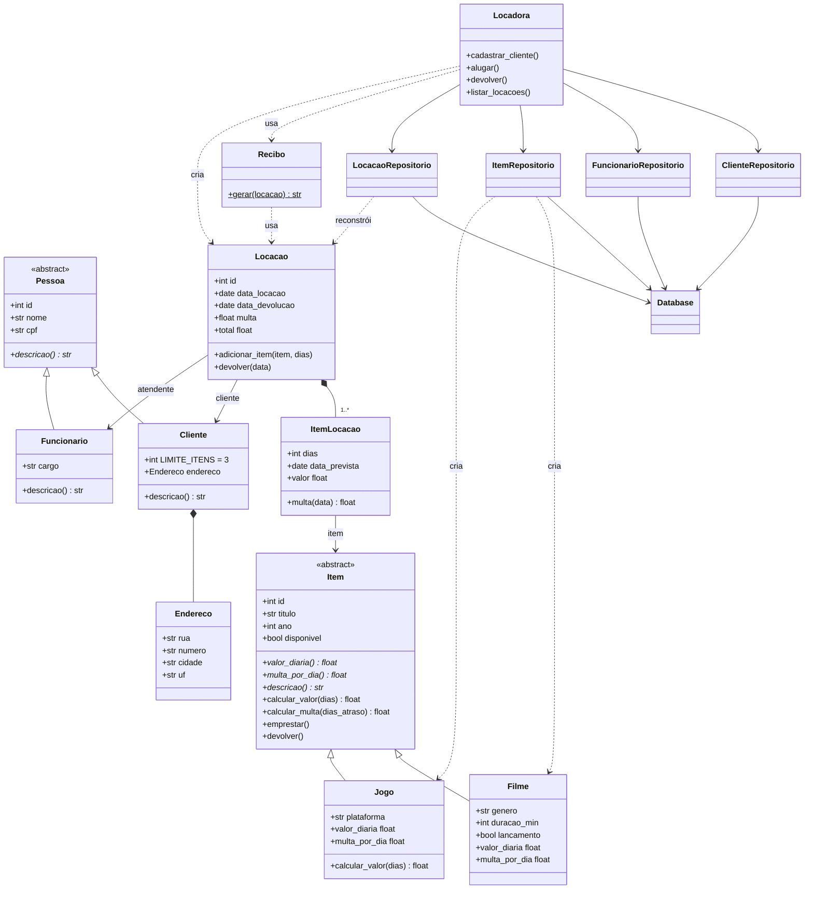

# Diagrama de classes da locadora

Para ver o desenho, cole o código abaixo (sem as linhas com três crases) em https://mermaid.live. No GitHub ele já aparece desenhado.

## Onde cada relação está no código

**Herança.** Cliente e Funcionario herdam de Pessoa (`models/pessoa.py`). Filme e Jogo herdam de Item (`models/item.py`).

**Polimorfismo.** Cada classe filha responde do seu jeito aos mesmos métodos: `descricao()`, `valor_diaria` e `multa_por_dia`. O Jogo ainda reescreve o `calcular_valor` para dar 10% de desconto a partir de 5 dias (`models/item.py`).

**Composição.** O Cliente cria o seu próprio Endereco (`models/pessoa.py`). A Locacao cria os seus ItemLocacao (`models/locacao.py`). Essas partes não fazem sentido sozinhas.

**Associação.** A Locacao guarda um Cliente e um Funcionario, e cada ItemLocacao guarda um Item. Esses objetos existem por conta própria, a locação só se liga a eles (`models/locacao.py`). A classe Locadora também guarda os repositórios (`servicos.py`).

**Dependência.** O Recibo recebe uma Locacao só como parâmetro do método `gerar` e não guarda ela (`models/recibo.py`).
