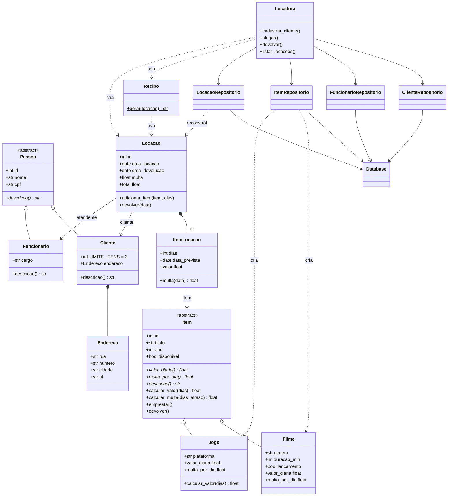

# Diagrama UML - Locadora

Cole o bloco abaixo em https://mermaid.live (ou no GitHub, que renderiza Mermaid automaticamente) para gerar a imagem.

## Onde cada relação aparece no código

| Relação | Onde | Arquivo |
|---|---|---|
| Herança | `Cliente`/`Funcionario` -> `Pessoa`; `Filme`/`Jogo` -> `Item` | `models/pessoa.py`, `models/item.py` |
| Polimorfismo | `descricao()`, `valor_diaria`, `multa_por_dia`; `Jogo.calcular_valor` sobrescrito (10% de desconto a partir de 5 dias) | `models/item.py`, `models/pessoa.py` |
| Composição | `Cliente` cria seu `Endereco`; `Locacao` cria seus `ItemLocacao` | `models/pessoa.py`, `models/locacao.py` |
| Associação | `Locacao` -> `Cliente`/`Funcionario`; `ItemLocacao` -> `Item`; `Locadora` -> repositórios | `models/locacao.py`, `servicos.py` |
| Dependência | `Recibo.gerar(locacao)` recebe a locação só como parâmetro | `models/recibo.py` |
